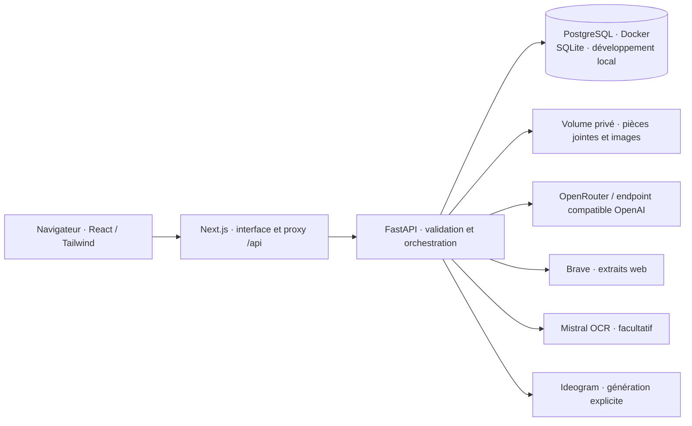

# Architecture de la première version

## Responsabilités

**Next.js** rend l'application, affiche les messages Markdown, les sources et les pièces jointes. Il transfère `/api/*` vers FastAPI. Le navigateur utilise une même origine et ne reçoit aucune clé API. Le proxy est configuré à la compilation par `BACKEND_URL` : `http://backend:8000` dans l'image Docker, backend local en développement. Il faut reconstruire le frontend si cette destination change.

**FastAPI** est la seule entrée pour les données et les services externes. Il valide les modèles autorisés, la taille des fichiers, les formats et les requêtes. Les adaptateurs `httpx` gardent les API fournisseurs remplaçables sans introduire de framework d'agents pour un simple tchat. Les erreurs de configuration et de fournisseur sont rendues explicitement au client.

**SQLAlchemy** gère l'historique, les résumés, les mémoires personnelles et les métadonnées de pièces jointes. PostgreSQL est la cible Compose ; SQLite facilite les tests et le développement. Les fichiers sont stockés séparément dans un répertoire privé du backend, servi par une route dédiée. PowerSync n'apporte rien au stockage serveur seul ; son intérêt serait une future synchronisation hors ligne.

## Envoi d'un message

1. L'interface téléverse les pièces jointes, puis envoie le texte, le modèle, l'option web et les identifiants de fichiers à la conversation choisie.
2. Le backend enregistre le message utilisateur et prépare le contexte : instructions, mémoires explicites, résumé des anciens échanges, messages récents, documents et éventuels résultats Brave.
3. Si la recherche est activée, une recherche Brave fournit des titres, liens et extraits. Les résultats accompagnent la réponse et restent consultables avec elle.
4. Le backend contacte le modèle et transfère ses fragments par **Server-Sent Events**. Le frontend traite aussi les événements de statut et d'erreur.
5. La réponse finale est persistée, puis le client recharge l'historique. Le résumé est mis à jour périodiquement pour les échanges suivants ; la conversation complète reste en base.

Les documents et contenus web restent des données non fiables. Ils ne doivent pas être traités comme une autorisation d'exécuter des commandes ou de changer les instructions du système. L'application ne donne aucun accès terminal au modèle.

## Contexte et coûts

`MAX_CONTEXT_CHARS` borne la quantité de texte transmise, `MAX_SUMMARY_CHARS` la synthèse et `MAX_UPLOAD_MB` la taille d'un fichier. Ces bornes sont exprimées en caractères et octets, pas en tokens facturés. Les limites de chaque modèle et fournisseur restent à respecter. Les images consomment aussi du contexte selon le fournisseur.

La mémoire personnelle est explicitement ajoutée/supprimée par l'utilisateur. Le résumé se construit à partir des messages de la conversation, sans devenir une copie automatique de toutes les mémoires globales. Une information peut toutefois figurer dans plusieurs conversations et réponses : supprimer une mémoire ne peut pas effacer ces copies rétrospectivement.

Pour de gros documents, une future ingestion par blocs avec récupération de passages et citations sera préférable à une simple troncature. PostgreSQL peut alors recevoir `pgvector`. Il n'est pas nécessaire d'ajouter Redis, Celery, une base vectorielle ou LangChain au premier périmètre.

## API applicative

| Route | Rôle |
| --- | --- |
| `GET /api/health` | Disponibilité de l'API et de la base |
| `GET /api/config` | Modèles autorisés, mode démo, outils configurés |
| `GET/POST /api/conversations` | Historique / création |
| `GET/PATCH/DELETE /api/conversations/{id}` | Messages, résumé, titre, modèle, suppression |
| `POST /api/conversations/{id}/messages` | Réponse SSE : `meta`, `status`, `delta`, `done`, `error` |
| `POST /api/attachments` | Téléversement multipart, champ `file` |
| `GET /api/attachments/{id}/file` | Consultation d'une pièce jointe |
| `DELETE /api/attachments/{id}` | Suppression d'un fichier téléversé mais pas encore envoyé |
| `GET/POST /api/memories` | Mémoires personnelles |
| `DELETE /api/memories/{id}` | Suppression d'une mémoire |
| `POST /api/conversations/{id}/images` | Génération Ideogram enregistrée dans la conversation |

Le schéma OpenAPI interactif est servi par FastAPI sur `/docs`. Le frontend utilise `fetch` et un lecteur SSE POST ; aucun abonnement WebSocket n'est nécessaire.

## Processus et données persistantes

Compose attend la santé de PostgreSQL avant de démarrer FastAPI, puis celle du backend avant Next. Les processus doivent être relancés dans un nouvel environnement ; les instructions de démarrage ne supposent pas que des serveurs survivent à un snapshot.

Les volumes Docker persistent indépendamment des conteneurs. Toute sauvegarde doit inclure **la base et les fichiers**, et être testée par restauration. La création initiale des tables convient au premier schéma ; les évolutions de schéma demanderont des migrations versionnées. Un changement de mot de passe `.env` ne modifie pas automatiquement celui d'une base PostgreSQL déjà initialisée.

Les API nécessitent `openrouter.ai`, `api.search.brave.com`, `api.mistral.ai`, `api.ideogram.ai` selon les fonctions activées, et les domaines de téléchargement effectivement retournés par Ideogram. L'allowlist exacte `IDEOGRAM_IMAGE_HOSTS` limite ces téléchargements (`ideogram.ai` par défaut), sans dépendre d'une résolution DNS locale incompatible avec certains proxys d'entreprise. La vérification TLS et la politique egress du cloud s'appliquent ensuite normalement. Les règles cloud, clés et accès réseau sont distincts du `.env` et des conteneurs. Les appels réels restent à vérifier avec ces prérequis.
